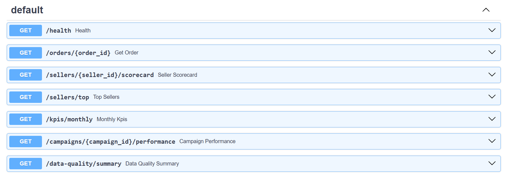

# Marketplace Seller Performance Pipeline

An end-to-end data engineering project that transforms Brazilian e-commerce transaction data into analytical datasets using Python, MySQL, and FastAPI.

## 1. Project Overview

This project implements an end-to-end data engineering pipeline for a Brazilian e-commerce marketplace using the Olist dataset.

The pipeline extracts transactional and reference data, integrates external APIs, applies 18 business rules, transforms the data into analytical datasets, and loads the results into a MySQL dimensional database.

A FastAPI service provides read-only access to seller performance, order details, monthly KPIs, campaign performance, and data quality metrics.

The project covers data extraction, transformation, business-rule implementation, dimensional modelling, data quality validation, and API development.

## 2. Technology Stack

| Technology | Purpose |
|---|---|
| Python 3 | Pipeline development |
| Pandas and NumPy | Data processing and transformation |
| MySQL 8.0 | Dimensional database |
| SQLAlchemy and PyMySQL | Database connectivity |
| FastAPI | REST API development |
| Pydantic | API data validation |
| Requests | External API integration |
| Pytest | Unit testing |

## 3. Project Architecture

```text
Olist CSV Datasets
        |
        v
   Data Extraction
        |
        v
   Raw Data Persistence
        |
        v
 External API Integration
        |
        v
 Business Rule Processing
        |
        v
 Data Transformation
        |
        v
 Dimension and Fact Loading
        |
        v
   MySQL Database
        |
        v
     FastAPI
        |
        v
 Analytical Endpoints
```

## 4. Project Structure

```text
marketplace-seller-performance-pipeline/
│
├── api/
│   └── main.py
│
├── data/
│   ├── input/       # Original datasets (not committed)
│   ├── raw/         # Persisted raw datasets (not committed)
│   └── internal/    # Internal business reference files
│
├── outputs/
│   └── data_quality_issues.csv
│
├── pipeline/
│   ├── check_data.py
│   ├── check_internal.py
│   ├── db.py
│   ├── external_apis.py
│   ├── extract.py
│   ├── holidays.py
│   ├── internal_data.py
│   ├── load_campaigns.py
│   ├── load_dimensions.py
│   ├── load_facts.py
│   ├── maintenance.py
│   ├── run.py
│   └── transform.py
│
├── sql/
│   └── schema.sql
│
├── tests/
│   └── test_business_rules.py
│
├── .env.example
├── .gitignore
├── ASSUMPTIONS.md
├── README.md
├── RESULTS.md
└── requirements.txt
```

## 5. Data Sources

### Primary Dataset

Brazilian E-Commerce Public Dataset by Olist.

The project uses nine datasets covering:

- Orders
- Order items
- Payments
- Reviews
- Customers
- Sellers
- Products
- Geolocation
- Product category translations

### External APIs

- **Frankfurter API:** BRL to USD currency conversion.
- **Nager.Date API:** Brazilian public holidays.
- **IBGE API:** Brazilian state and geographic region mapping.

### Internal Reference Files

- `commission_rates.csv`
- `category_commission_overrides.csv`
- `category_translation_patch.csv`
- `campaigns.json`

## 6. Business Rules

The pipeline implements 18 business rules covering:

- Customer identity and revenue eligibility.
- Payment reconciliation and currency conversion.
- Category resolution and commission calculation.
- Business-day delivery performance.
- Seller tiers and commission rates.
- Review deduplication.
- Geolocation and delivery distance.
- State-region mapping.
- Campaign attribution.

Detailed business decisions and assumptions are documented in `ASSUMPTIONS.md`.

## 7. Database Design

The project uses a MySQL dimensional data model.

### Dimension Tables

- `dim_customer`
- `dim_seller`
- `dim_product`
- `dim_campaign`

### Fact Tables

- `fact_order`
- `fact_order_item`
- `fact_seller_monthly`
- `fact_seller_order_delivery`
- `fact_order_review`

### Pipeline Monitoring and Data Quality

- `data_quality_issue`
- `pipeline_run`

The database schema is provided in `sql/schema.sql`.

## 8. Installation and Setup

### Prerequisites

- Python 3.10+
- MySQL 8.x
- Git

### Clone the repository

```bash
git clone https://github.com/nancynagpal12/marketplace-seller-performance-pipeline.git
cd marketplace-seller-performance-pipeline
```

### Create a virtual environment

```bash
python -m venv .venv
```

Activate it on Windows CMD:

```cmd
.venv\Scripts\activate
```

### Install dependencies

```bash
pip install -r requirements.txt
```

### Configure environment variables

Create a local `.env` file using the supplied template:

```cmd
copy .env.example .env
```

Update the database credentials in `.env`:

```env
DB_USER=root
DB_PASSWORD=your_mysql_password
DB_HOST=localhost
DB_PORT=3306
DB_NAME=marketplace_seller_pipeline
```

Do not commit your `.env` file or expose database credentials.

### Configure MySQL

Create the database:

```sql
CREATE DATABASE marketplace_seller_pipeline;
```

Apply the database schema from `sql/schema.sql` using your MySQL client.

### Prepare input data

Download the nine original Olist CSV datasets and place them inside:

```text
data/input/
```

Place the internal reference files inside:

```text
data/internal/
```

The original datasets are excluded from this GitHub repository to avoid committing large duplicate CSV files.

## 9. Running the Pipeline

Execute the pipeline:

```bash
python -m pipeline.run --start-date 2017-01-01 --end-date 2018-08-31
```

The pipeline performs:

1. Data extraction.
2. Raw data persistence.
3. Dimension loading.
4. Business-rule processing and transformations.
5. Fact-table loading.
6. Data quality tracking.

Only orders whose purchase timestamps fall within the requested date range are processed.

## 10. Running the FastAPI Service

Start the API:

```bash
uvicorn api.main:app --reload
```

Interactive API documentation:

```text
http://127.0.0.1:8000/docs
```

Alternative documentation:

```text
http://127.0.0.1:8000/redoc
```

## 11. API Endpoints

| Method | Endpoint | Description |
|---|---|---|
| GET | `/health` | Service and database health |
| GET | `/orders/{order_id}` | Order details |
| GET | `/sellers/{seller_id}/scorecard` | Monthly seller scorecard |
| GET | `/sellers/top` | Seller rankings |
| GET | `/kpis/monthly` | Monthly marketplace KPIs |
| GET | `/campaigns/{campaign_id}/performance` | Campaign performance |
| GET | `/data-quality/summary` | Data quality summary |

## 12. Testing

Run the test suite:

```bash
python -m pytest -v
```

Latest verified test result:

**10 tests passed, with 1 non-blocking Pandas deprecation warning.**

The tests cover important business rules, including:

- R6 – Currency conversion.
- R9 – Business-day lead time.
- R12 – Seller tiers.
- R13 – Commission calculation.
- R18 – Campaign attribution.

## 13. Verified Pipeline Results

The complete requested processing period was successfully executed:

```text
Start date: 2017-01-01
End date:   2018-08-31
Rows processed: 422,385
```

### Fact Table Row Counts

| Fact Table | Rows |
|---|---:|
| fact_order | 98,207 |
| fact_order_item | 112,101 |
| fact_seller_monthly | 16,068 |
| fact_seller_order_delivery | 97,810 |
| fact_order_review | 99,542 |

### Data Quality Results

The final pipeline run recorded 867 data quality issues across

## API Documentation

The project exposes seven read-only REST API endpoints for marketplace seller performance analytics.

The interactive API documentation is available through FastAPI Swagger UI.

